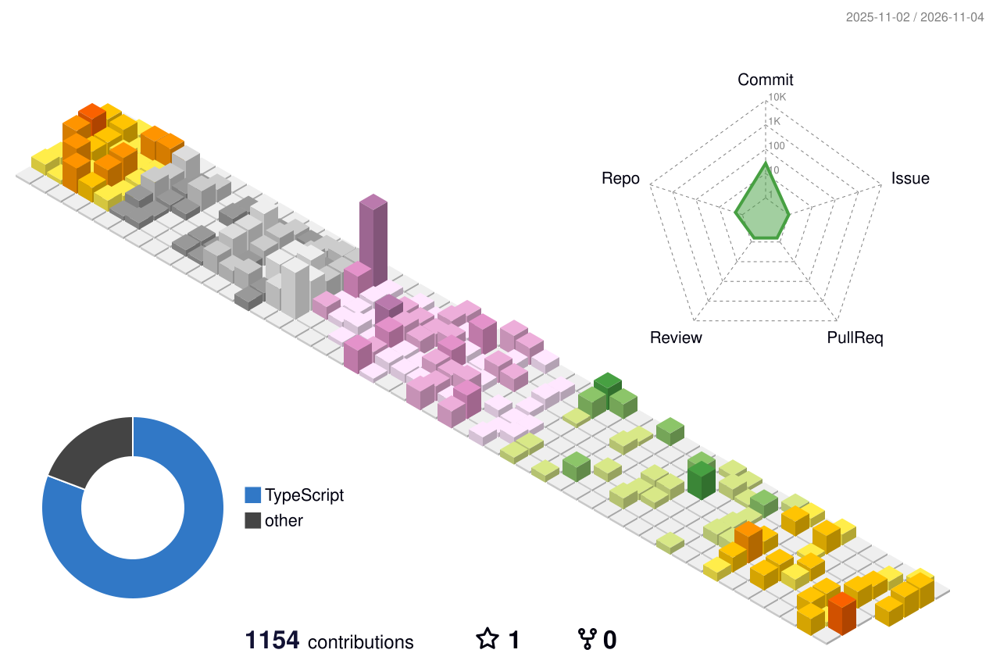

  

  
  

### 🛠 Tech Stack

  
  
  
  
  
  
  
  
  
  
  

### 📊 Stats & Languages

  <picture>
    <source media="(prefers-color-scheme: dark)" srcset="profile-3d-contrib/profile-night-rainbow.svg" />
    
  </picture>

### 🐍 Contribution Snake

  <picture>
    <source media="(prefers-color-scheme: dark)" srcset="assets/snake-dark.svg" />
    
  </picture>

### 🚀 About Me

- 💻 I build responsive, performant web apps
- ⚡ Vue is home, with a bit of React on the side
- 🌱 Currently going deeper into TypeScript
- 🎸 Off the keyboard, I play guitar
- 📫 Reach me on [LinkedIn](https://www.linkedin.com/in/yurii-kasko)

Images refresh daily via GitHub Actions

